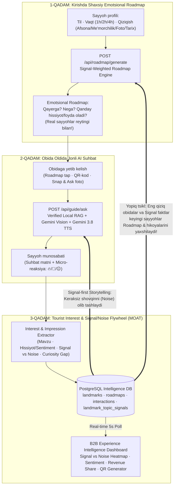
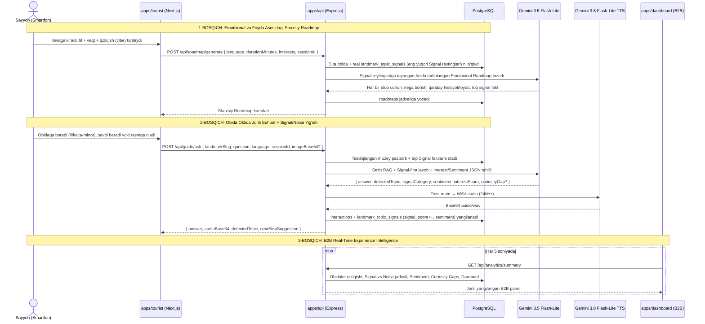
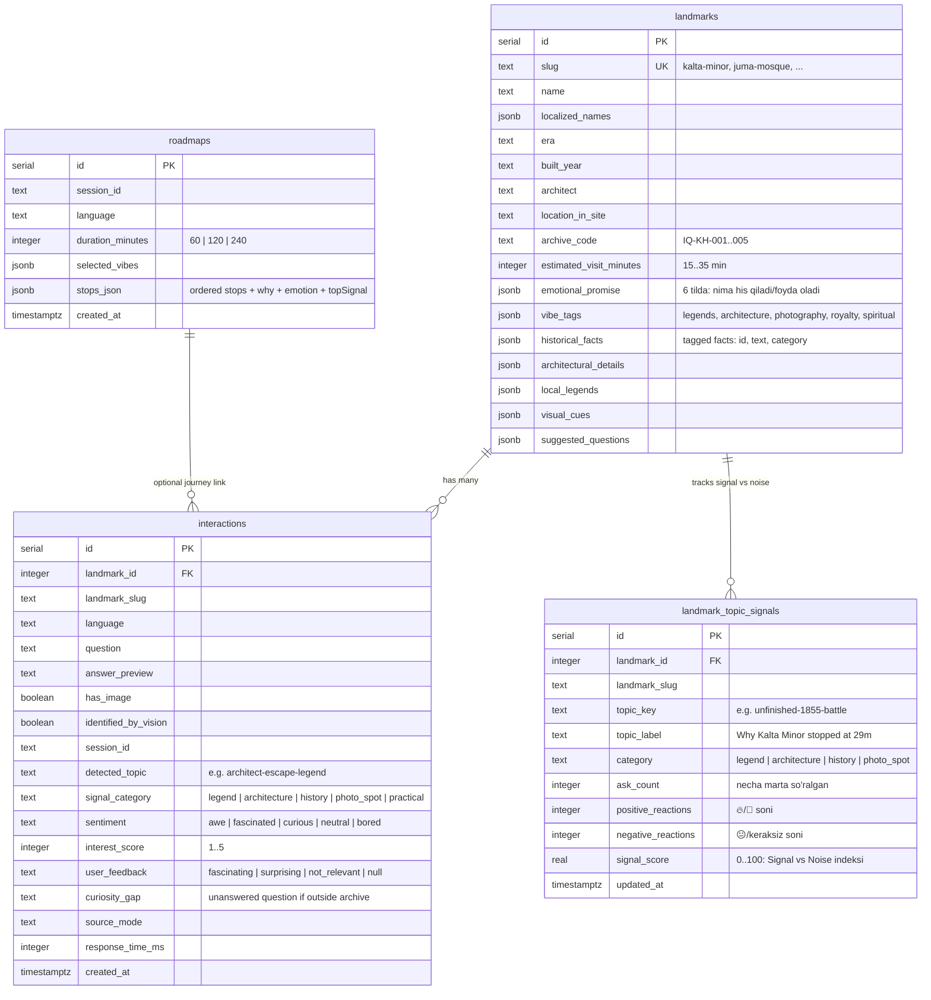

# SmartGuide — Tizim Arxitekturasi va Data Flywheel Dizayni

Ushbu hujjat **SmartGuide** ning yakuniy mahsulot arxitekturasini — **Emotsional Shaxsiy Roadmap → Jonli Obida Suhbatlari → Sayyoh Qiziqishi va Signal/Noise Intellekti (Self-Learning Flywheel)** tizimini texnik jihatdan to'liq tushuntiradi.

---

## 1. Yopiq Zanjirli Data Flywheel Arxitekturasi (Boshqa AI'lardan Asosiy Farqimiz)

---

## 2. To'liq So'rovlar Ketma-Ketligi (Sequence Diagram)

---

## 3. Ma'lumotlar Bazasi Sxemasi (PostgreSQL + Drizzle ORM)

---

## 4. "Signal vs. Noise" Ajratish Mexanizmi Qanday Ishlaydi?

Oddiy AI har bir obida uchun 20 ta faktning hammasini bir xil vaznda saqlaydi. SmartGuide'da esa har bir fakt/mavzu o'z **Signal Score (`0–100`)** indeksiga ega:

$$\text{Signal Score} = \text{clamp}\left(50 + 6 \cdot \ln(1 + \text{ask\_count}) + 12 \cdot \text{positive\_reactions} - 18 \cdot \text{negative\_reactions} + 8 \cdot \text{avg\_awe\_bonus},\; 0,\; 100\right)$$

- **`Signal Score >= 75` (High Signal / "Oltin fakt"):**
  - Yangi sayyohning **Emotsional Roadmap** kartasida *"Sayyohlarni eng ko'p hayratlantirgan nuqta"* sifatida chiqadi.
  - Jonli suhbatda AI birinchi navbatda shu mavzularni jonli, qisqa hikoya qilib beradi.
- **`Signal Score < 35` (Low Signal / "Noise — Ahamiyatsiz"):**
  - AI buni o'zidan-o'zi cho'zib gapirib sayyohni zeriktirmaydi (faqat sayyoh aniq so'rasa javob beradi).
  - B2B Dashboard'da muzey ma'muriyatiga *"Sayyohlar e'tibor bermayotgan ma'lumotlar"* bo'limida ko'rsatiladi!

---

## 5. Barqarorlik va Graceful Degradation (4 Qatlamli Himoya)

1. **Model Fallback:** `gemini-3.5-flash-lite` xato bersa → avtomatik `gemini-4-hydrogen`.
2. **Offline/Archive Fallback:** API kalit ishlamasa ham, Roadmap va RAG javoblari PostgreSQL'dagi tasdiqlangan `landmarks` + `landmark_topic_signals` dan deterministik tarzda qaytadi (`500` xato chiqmaydi!).
3. **TTS Fallback:** Gemini 3.8 TTS kechiksa yoki xato bersa → Frontend `AudioGuidePlayer` brauzerning `speechSynthesis` ovoziga o'tadi.
4. **Smart Cache:** Bir xil tezkor savollar keshdan `<100ms` va `$0` API xarajatida qaytadi, lekin har bir savol baribir `interactions` va `landmark_topic_signals` ni yangilaydi!
