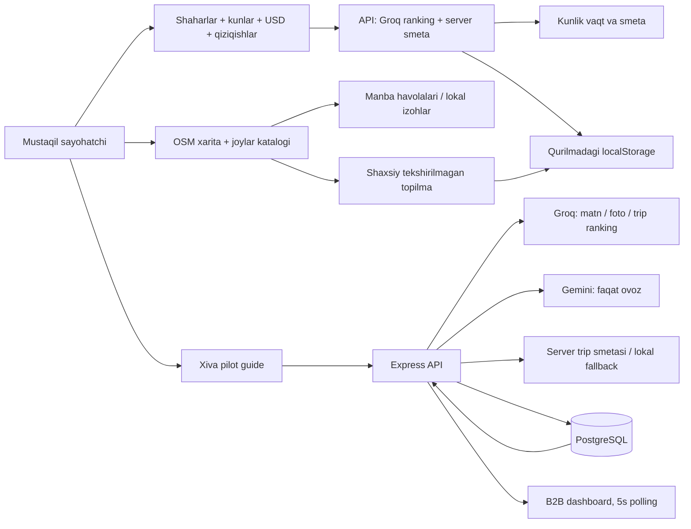

# SmartGuide — arxitektura va amaldagi integratsiya

26-noyabr 2026. **Mahsulot ko'lami (muhim):** SmartGuide **faqat Ichan-Qal'a ilovasi emas** — asosiy oqim sayyoh tashrif buyuradigan **istalgan shahar(lar)** (Oʻzbekiston boʻylab 16 ta shahar + erkin shahar) boʻylab aylanish uchun **toʻliq kunlik Roadmap + USD byudjet smetasi + interaktiv xarita + manbali hikoyalar** yaratishdir. Xiva (**Ichan-Qal'a**, 5 ta obida) esa shu platformaning chuqurlashtirilgan **1-bosqich RAG/Vision AI-gid piloti** va B2B analitika sinov qatlamidir.

## Hozirgi qatlamlar

`apps/tourist/src/lib/trip-api.ts`: haqiqiy plan POST va response validatsiyasi. `journey.ts`: vaqt/pul/katalog validatsiyasi, proyeksiya, AI tartibi va generation metadata bilan localStorage tiklash; eski triplar migratsiyasi uchun lokal hisoblash saqlangan. `places.ts`: 16 shahar va 15 joy. Narxlar taxmin, real quote/qatnov jadvali emas.

`DiscoveryMap.tsx`: visible OSM tile lar, attribution, pan/zoom va markerlar. Bu navigatsiya/routing engine emas. `TouristHomeClient.tsx`: plan / itinerary / map, fotosuratni mavjud Xiva API ga joʻnatish, shaxsiy qoralama dialogi. `journey-copy.ts`: 6 til UI; katalog hikoyalari hozir EN/RU/UZ.

`/khiva`: oldingi qisqa yurish builderi, `/l/[slug]`: mavjud 5 obida uchun AI matn, ovoz, foto, transkript, retry va micro-feedback UI. Lokal milliy trip va eski qisqa roadmap alohida formatlarda saqlanadi.

## Backendning repodagi haqiqiy holati

| Endpoint | Runtime |
| --- | --- |
| GET `/api/health` | Bor; DB va AI konfiguratsiyasini bildiradi |
| GET `/api/landmarks` | Bor; Xiva katalogi |
| GET `/api/landmarks/:slug` | Bor; bitta dossier |
| POST `/api/guide/ask` | Bor; RAG/Vision/TTS va interaction log |
| POST `/api/trips/generate` | Bor; milliy frontend ulangan, Groq ranking + server smeta |
| POST `/api/audio/speech` | Bor; Gemini WAV va model fallback |
| GET `/api/analytics/summary` | Bor; mavjud analytics tiplari |
| POST `/api/roadmap/generate` | Bor; 2/3/5 stopli Xiva AI yurishi, DB persistence yoʻq |
| Feedback / nearby / visit / export | Hali route ulanmagan |

Mavjud umumiy tiplarda milliy trip, signals, sentiment va contribution kontraktlari yoʻq. Frontend kengaytmalari optional lokal tiplarda. Mavjud DB sxemasida `landmarks` va `interactions` bor; kengaytirilgan flywheel jadvallari loyiha taklifi, bajarilgan migratsiya emas.

## Maʼlumot va xatolar

- API ishlamasa saqlangan reja, statik katalog va lokal topilmalar ochiladi; yangi plan retry xatosini koʻrsatadi. Server fallbacki alohida belgilanadi. Xarita tile lari internetga bogʻliq.
- Backend health OK — real AI yoqilganini yoki kontent tarixchi tasdigʻidan oʻtganini anglatmaydi. `aiConfigured`, `sourceMode` va manbalar alohida tekshiriladi.
- Browser speech synthesis — TTS fallback; ovoz va til qurilmada mavjud boʻlishiga bogʻliq. Audio matni o‘qish har doim mumkin.
- Roadmap endpoint xatosida Xiva builder lokal curated marshrutni belgilab chiqaradi. Feedback endpoint xatosida «saqlandi» deyilmaydi.
- Dashboard eski maʼlumotni saqlab reconnect holatini bildiradi; yangi insight maydonlari kelmasa bo‘sh holat. Kalkulyator API tushumi emas.
- RAG, cache va audio kechikishi uchun 0% xato / doim <100ms / doim $0 vaʼdasi yoʻq.

Hozirgi live runtime ikkala rejimni qoʻllab-quvvatlaydi: `LANDMARK_STORE=postgres` (PostgreSQL bazasi, jonli interaksiyalar va B2B analitika) hamda DB siz tezkor demo uchun `LANDMARK_STORE=json`. Tourist ilovasi installable PWA (`manifest.webmanifest`, `sw.js`, PNG iconlar) bilan jihozlangan. Public HTTPS production deploy — keyingi bosqich ishi. [LIVE_API_SETUP.md](LIVE_API_SETUP.md).

## Keyingi arxitektura — kelishilishi kerak

Milliy city/place katalogi va manba versiyalari; trip backendga saqlash; transport/tarif manbalari; contribution moderation va huquqlar; opt-in GPS; nationwide vision; payment/payout; agregat feedback va analytics. `feat/ai-provider-routing` foydalanuvchi topshirigʻi bilan backend va shared guide sourceMode tipini kengaytiradi; DB migratsiyasi yoʻq. [AI backend handoff](AI_BACKEND_HANDOFF.md) da provider/quota, import va testlar bayoni bor.

Feedback loop faqat o‘lchangan va yetarli namunadagi reaksiyalarga tayanishi kerak. Tilni millat deb olish, kam savol berilgan joyni «zerikarli» deb fakt sifatida chiqarish yoki soxta foizlarni UIga qoʻshish mumkin emas. Kontrakt va rollar: [API_CONTRACT.md](API_CONTRACT.md), [FRONTEND_PRODUCT.md](FRONTEND_PRODUCT.md).
