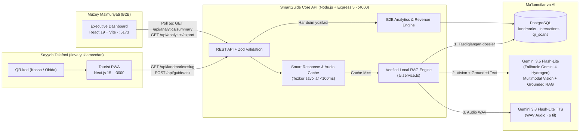
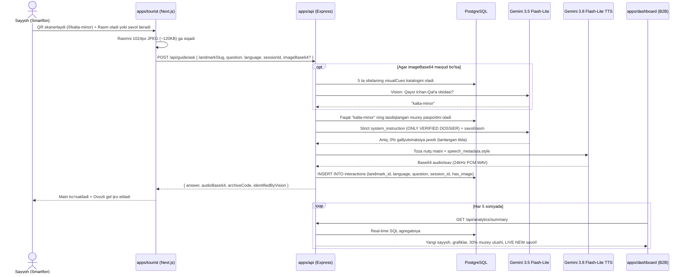
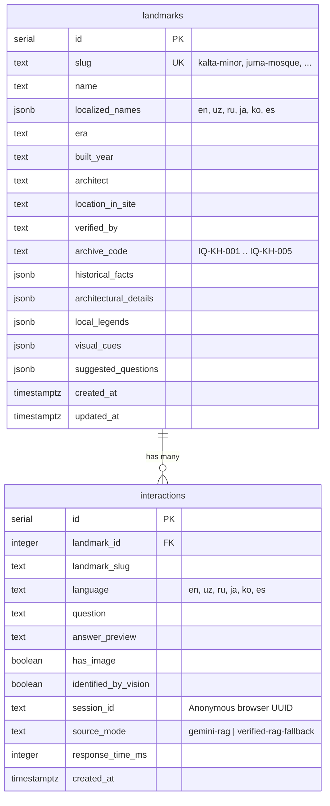

# SmartGuide — Tizim Arxitekturasi va Texnik Dizayn

Ushbu hujjat texnik mentorlar (Behruz Saidjonov, Aziza Turaeva), hakamlar hay'ati va yangi qo'shilayotgan dasturchilar uchun **SmartGuide** tizimining to'liq arxitekturasini tushuntiradi.

---

## 1. Umumiy Tizim Arxitekturasi

---

## 2. "Snap & Ask" + Zero-Hallucination RAG Ishlash Ketma-Ketligi

---

## 3. Ma'lumotlar Bazasi Sxemasi (PostgreSQL + Drizzle ORM)

**Indekslar (Tezkor B2B agregatsiya uchun):**
- `idx_interactions_landmark_id`
- `idx_interactions_language`
- `idx_interactions_session_id`
- `idx_interactions_created_at`

---

## 4. Nima Uchun "Structured Verified Dossier Injection" (Chunking o'rniga)?

Oddiy RAG tizimlari hujjatlarni 500 tokenlik bo'laklarga (chunks) bo'lib, vektor qidiruvda ko'pincha muhim sanalar yoki afsona kontekstini yo'qotib qo'yadi.  
Ichan-Qal'a kabi tarixiy obidalarda esa:
1. Sayyoh **QR-kod** yoki **Snap & Ask Vision** orqali aynan qaysi obida oldida turgani 100% ma'lum bo'ladi.
2. Bitta obidaning to'liq tasdiqlangan muzey pasporti atigi **~800–1,200 token** — bu `gemini-3.5-flash-lite` (1M token kontekst) ga to'liq, hech bir detalni yo'qotmasdan sig'adi!
3. Natija: **0% kontekst uzilishi, 0% gallyutsinatsiya**, minimal infratuzilma (qo'shimcha Vector DB kerak emas — faqat PostgreSQL!).

---

## 5. Unit-Ekonomika va Barqarorlik (B2B2C Modeli)

| Ko'rsatkich | Qiymat | Izoh |
| :--- | :--- | :--- |
| Chipta ustamasi (sayyoh to'lovi) | **$4.00 / sayyoh** | Jonli giddan ($40–$60) 10 baravar arzon |
| Muzey ulushi (B2B Revenue Share) | **$1.20 (30%)** | Muzey uchun $0 kapital xarajat + bepul analitika paneli |
| SmartGuide ulushi | **$2.80 (70%)** | Server va AI xarajatlarini qoplaydi |
| O'rtacha Gemini API xarajati | **~$0.15 / sayyoh** | `gemini-3.5-flash-lite` + `gemini-3.8-flash-lite-tts` + tezkor savollar keshi |
| Yalpi marja (Gross Margin) | **~95%+** | Sog'lom SaaS/B2B2C unit-ekonomika (`LTV >= 3 x CAC`) |

### Graceful Degradation (Ishonchlilik Qatlamlari)
1. **Model fallback:** `gemini-3.5-flash-lite` xato bersa → avtomatik `gemini-4-hydrogen`.
2. **Offline/Quota fallback:** Gemini API umuman javob bermasa → PostgreSQL'dagi tasdiqlangan arxivdan deterministik matn qaytadi (`sourceMode: "verified-rag-fallback"`).
3. **TTS fallback:** Gemini TTS javob bermasa → Frontend `AudioGuidePlayer` avtomatik qurilmaning o'z `speechSynthesis` ovoziga o'tadi.
4. **Rasm fallback:** Obida fotosi yuklanmasa → `LandmarkArt` maxsus vektor SVG illyustratsiyani ko'rsatadi.
