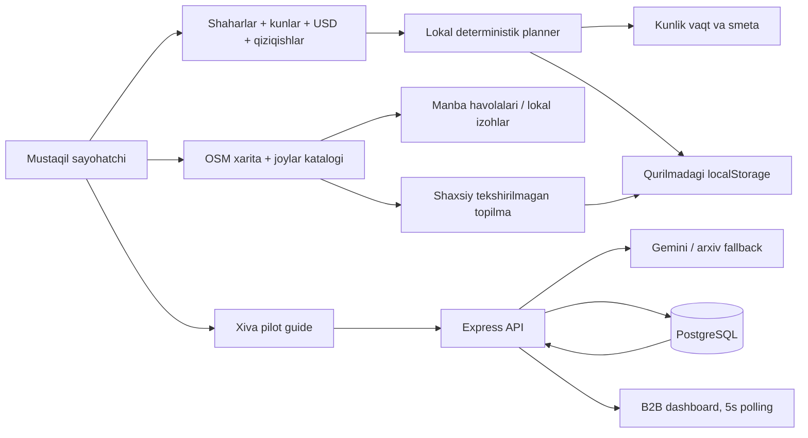

# SmartGuide — arxitektura va amaldagi integratsiya

26-noyabr 2026. Mahsulotning asosiy oqimi: mustaqil sayohatchi → kunlar/byudjet/qiziqishlar → safar → mahalliy xarita → manbali izoh. Xiva AI-piloti va B2B analitika shu mahsulotning alohida qatlamlari.

## Hozirgi qatlamlar

`apps/tourist/src/lib/journey.ts`: validatsiya, byudjetni yigʻish, zaxira va kamomad, proyeksiya, localStorage inputni qayta hisoblash. `places.ts`: 16 shahar va 15 joy. Joylar narxi operator kiritgan taxmin, amaldagi quote emas. Yetarli kontent boʻlmasa planner erkin vaqtni ochiq belgilaydi. Har yangi shahar uchun transfer kuni ajratiladi; real qatnov jadvali hisoblanmaydi.

`DiscoveryMap.tsx`: visible OSM tile lar, attribution, pan/zoom va markerlar. Bu navigatsiya/routing engine emas. `TouristHomeClient.tsx`: plan / itinerary / map, fotosuratni mavjud Xiva API ga joʻnatish, shaxsiy qoralama dialogi. `journey-copy.ts`: 6 til UI; katalog hikoyalari hozir EN/RU/UZ.

`/khiva`: oldingi qisqa yurish builderi, `/l/[slug]`: mavjud 5 obida uchun AI matn, ovoz, foto, transkript, retry va micro-feedback UI. Lokal milliy trip va eski qisqa roadmap alohida formatlarda saqlanadi.

## Backendning repodagi haqiqiy holati

| Endpoint | Runtime |
| --- | --- |
| GET `/api/health` | Bor; DB va AI konfiguratsiyasini bildiradi |
| GET `/api/landmarks` | Bor; Xiva katalogi |
| GET `/api/landmarks/:slug` | Bor; bitta dossier |
| POST `/api/guide/ask` | Bor; RAG/Vision/TTS va interaction log |
| GET `/api/analytics/summary` | Bor; mavjud analytics tiplari |
| Roadmap / feedback / nearby / visit / export | Hali route ulanmagan; oldingi kontraktdagi takliflar |

Mavjud umumiy tiplarda milliy trip, signals, sentiment va contribution kontraktlari yoʻq. Frontend kengaytmalari optional lokal tiplarda. Mavjud DB sxemasida `landmarks` va `interactions` bor; kengaytirilgan flywheel jadvallari loyiha taklifi, bajarilgan migratsiya emas.

## Maʼlumot va xatolar

- API ishlamasa milliy reja, statik katalog va lokal topilmalar ishlaydi. Xarita tile lari alohida internet xizmatiga bogʻliq; roʻyxat saqlanadi.
- Backend health OK — real AI yoqilganini yoki kontent tarixchi tasdigʻidan oʻtganini anglatmaydi. `aiConfigured`, `sourceMode` va manbalar alohida tekshiriladi.
- Browser speech synthesis — TTS fallback; ovoz va til qurilmada mavjud boʻlishiga bogʻliq. Audio matni o‘qish har doim mumkin.
- Roadmap endpoint xatosida Xiva builder lokal curated marshrutni belgilab chiqaradi. Feedback endpoint xatosida «saqlandi» deyilmaydi.
- Dashboard eski maʼlumotni saqlab reconnect holatini bildiradi; yangi insight maydonlari kelmasa bo‘sh holat. Kalkulyator API tushumi emas.
- RAG, cache va audio kechikishi uchun 0% xato / doim <100ms / doim $0 vaʼdasi yoʻq.

## Keyingi arxitektura — kelishilishi kerak

Milliy city/place katalogi va manba versiyalari; trip backendga saqlash; transport/tarif manbalari; contribution moderation va huquqlar; opt-in GPS; nationwide vision; payment/payout; agregat feedback va analytics. Ushbu branch backend yoki shared runtime ni oʻzgartirmaydi.

Feedback loop faqat o‘lchangan va yetarli namunadagi reaksiyalarga tayanishi kerak. Tilni millat deb olish, kam savol berilgan joyni «zerikarli» deb fakt sifatida chiqarish yoki soxta foizlarni UIga qoʻshish mumkin emas. Kontrakt va rollar: [API_CONTRACT.md](API_CONTRACT.md), [FRONTEND_PRODUCT.md](FRONTEND_PRODUCT.md).
