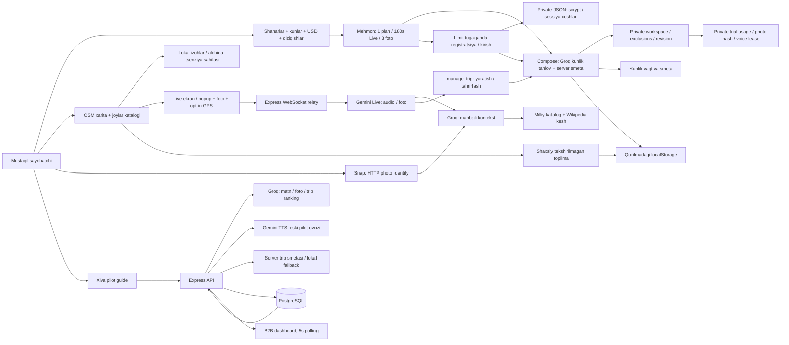

# SmartGuide — arxitektura va amaldagi integratsiya

26-noyabr 2026. **Mahsulot ko'lami (muhim):** SmartGuide **faqat Ichan-Qal'a ilovasi emas** — asosiy oqim sayyoh tashrif buyuradigan **istalgan shahar(lar)** (Oʻzbekiston boʻylab 16 ta shahar + erkin shahar) boʻylab aylanish uchun **toʻliq kunlik Roadmap + USD byudjet smetasi + interaktiv xarita + manbali hikoyalar** yaratishdir. Xiva (**Ichan-Qal'a**, 5 ta obida) esa shu platformaning chuqurlashtirilgan **1-bosqich RAG/Vision AI-gid piloti** va B2B analitika sinov qatlamidir.

## Hozirgi qatlamlar

[Joriy Stitch dizayni va auth](STITCH_IMPLEMENTATION.md): oldingi uch bo‘lim o‘rniga yetti URL view; haqiqiy registratsiya/kirish va same-origin HttpOnly sessiyasi. Qoʻlda yoki Live bilan reja avval trial orqali ishlaydi; registratsiya faqat kerakli limit tugaganda taklif qilinadi. Parol/sessiya xeshlari, trial va oxirgi workspace private JSON fayllarda, faqat bitta API process uchun; PostgreSQL migratsiyasi va production sync/history keyingi ish. [Trial va reja](TRIAL_AND_PLANNING.md).

`apps/tourist/src/lib/trip-api.ts`: haqiqiy `/compose` POST, `/current` va response validatsiyasi. Manual forma, matnli oʻzgartirish, joyni oʻchirish va Live `manage_trip` bitta workspaceʼni yangilaydi. `access-api.ts` server trial qoldigʻini oladi. `journey.ts`: vaqt/pul/katalog validatsiyasi, proyeksiya, AI tartibi va generation metadata bilan localStorage tiklash; eski triplar migratsiyasi uchun lokal hisoblash saqlangan. `places.ts`: 16 shahar va 15 asosiy joy; `trip.places` yangi source recordsʼni ham saqlaydi va tekshiradi. Narxlar taxmin, real quote/qatnov jadvali emas.

`DiscoveryMap.tsx`: visible OSM tile lar, attribution, pan/zoom va markerlar. Bu navigatsiya/routing engine emas. `TouristHomeClient.tsx` entry pointi `SmartGuideHub.tsx`ni ochadi: plan / auth / itinerary / map / snap / guide / pass, shaxsiy qoralama, haqiqiy auth va `MapVoiceAssistant.tsx` ekran/popup. Foto Live-sessiyaga yoki alohida Snap HTTP endpointiga yuboriladi; GPS faqat tugma bosilganda olinadi. [Live arxitektura va kontrakt](LIVE_VOICE_ASSISTANT.md). UI 6 til; katalog hikoyalari hozir EN/RU/UZ.

`/khiva`: oldingi qisqa yurish builderi, `/l/[slug]`: mavjud 5 obida uchun AI matn, ovoz, foto, transkript, retry va micro-feedback UI. Lokal milliy trip va eski qisqa roadmap alohida formatlarda saqlanadi.

## Backendning repodagi haqiqiy holati

| Endpoint | Runtime |
| --- | --- |
| GET `/api/health` | Bor; DB va AI konfiguratsiyasini bildiradi |
| GET `/api/landmarks` | Bor; Xiva katalogi |
| GET `/api/landmarks/:slug` | Bor; bitta dossier |
| POST `/api/guide/ask` | Bor; RAG/Vision/TTS va interaction log |
| POST `/api/trips/compose` | Bor; qoʻlda/Live Groq kunlik tanlov, exclusions, summary va revision |
| GET `/api/trips/current`, GET `/api/access` | Bor; private workspace va 1 plan/180s/3 foto server trial |
| POST `/api/trips/generate` | Legacy compatibility; Groq ranking + server smeta, belgilangan local-fallback |
| POST `/api/audio/speech` | Bor; Gemini WAV va model fallback |
| GET `/api/explore/places` | Bor; milliy katalog va opt-in GPS bo‘yicha yaqin joylar |
| POST `/api/explore/identify` | Bor; mikrofonsiz Snap, JPEG va manbali Groq javobi |
| `/api/auth/register`, `/login`, `/session`, `/logout` | Bor; scrypt, HttpOnly cookie, private single-process JSON-store |
| POST `/api/explore/live/session` + WS `/api/explore/live` | Bor; bir martalik token, Gemini Live audio/foto va Groq kontekst |
| GET `/api/analytics/summary` | Bor; mavjud analytics tiplari |
| POST `/api/roadmap/generate` | Bor; 2/3/5 stopli Xiva AI yurishi, DB persistence yoʻq |
| Feedback / nearby / visit / export | Hali route ulanmagan |

Mavjud umumiy tiplarda milliy trip, signals, sentiment va contribution kontraktlari yoʻq. Frontend kengaytmalari optional lokal tiplarda. Mavjud DB sxemasida `landmarks` va `interactions` bor; kengaytirilgan flywheel jadvallari loyiha taklifi, bajarilgan migratsiya emas.

## Maʼlumot va xatolar

- API ishlamasa saqlangan reja, statik katalog va lokal topilmalar ochiladi; yangi compose/revise retry xatosini koʻrsatadi va avvalgi rejani almashtirmaydi. Yangi compose soxta lokal AI plan bermaydi; belgilangan fallback faqat eski endpointlarda. Xarita tile lari internetga bogʻliq.
- Backend health OK — real AI yoqilganini yoki kontent tarixchi tasdigʻidan oʻtganini anglatmaydi. `aiConfigured`, `sourceMode` va manbalar alohida tekshiriladi.
- Browser speech synthesis — TTS fallback; ovoz va til qurilmada mavjud boʻlishiga bogʻliq. Audio matni o‘qish har doim mumkin.
- Roadmap endpoint xatosida Xiva builder lokal curated marshrutni belgilab chiqaradi. Feedback endpoint xatosida «saqlandi» deyilmaydi.
- Dashboard eski maʼlumotni saqlab reconnect holatini bildiradi; yangi insight maydonlari kelmasa bo‘sh holat. Kalkulyator API tushumi emas.
- RAG, cache va audio kechikishi uchun 0% xato / doim <100ms / doim $0 vaʼdasi yoʻq.

Hozirgi live runtime ikkala rejimni qoʻllab-quvvatlaydi: `LANDMARK_STORE=postgres` (PostgreSQL bazasi, jonli interaksiyalar va B2B analitika) hamda DB siz tezkor demo uchun `LANDMARK_STORE=json`. Tourist ilovasi installable PWA (`manifest.webmanifest`, `sw.js`, PNG iconlar) bilan jihozlangan. Public HTTPS production deploy — keyingi bosqich ishi. [LIVE_API_SETUP.md](LIVE_API_SETUP.md).

## Keyingi arxitektura — kelishilishi kerak

Milliy katalogni kengaytirish va tarixiy review; private JSONʼdagi auth/trial/workspaceʼni DBga koʻchirish, shared limiter/lease va production sync/history; transport/tarif manbalari; contribution moderation va huquqlar; Live ovoz/foto/GPS ni telefonlarda va public WSS da tekshirish; foto aniqligi eval; payment/payout; agregat feedback va analytics. Opt-in GPS va milliy Live popup allaqachon bor. DB migratsiyasi yo‘q. [AI backend handoff](AI_BACKEND_HANDOFF.md), [Live deployment](LIVE_VOICE_ASSISTANT.md).

Feedback loop faqat o‘lchangan va yetarli namunadagi reaksiyalarga tayanishi kerak. Tilni millat deb olish, kam savol berilgan joyni «zerikarli» deb fakt sifatida chiqarish yoki soxta foizlarni UIga qoʻshish mumkin emas. Kontrakt va rollar: [API_CONTRACT.md](API_CONTRACT.md), [FRONTEND_PRODUCT.md](FRONTEND_PRODUCT.md).
