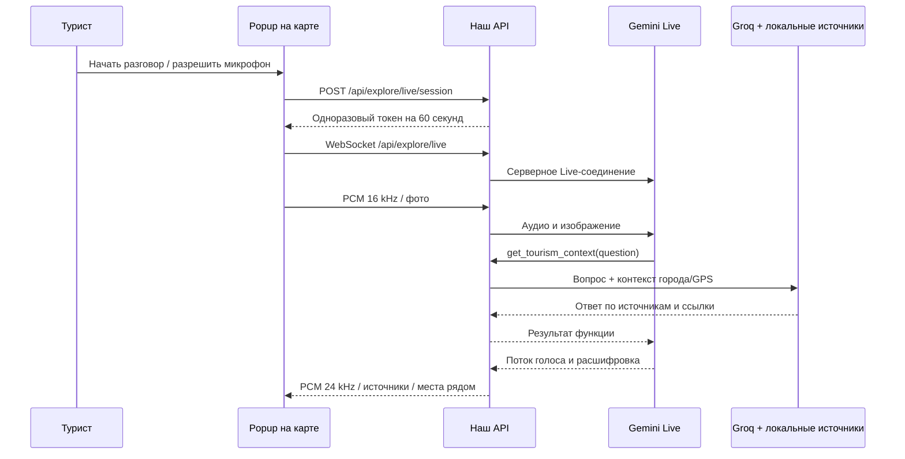

# Голосовой помощник SmartGuide

26 ноября 2026. В новой навигации **Roadmap / Карта / Snap / AI-гид / Pass** доступен полноценный экран **Live AI-гид** и контекстный голосовой popup, без интерфейса текстового чата. Одна реализация позволяет разговаривать с Gemini Live, перебивать ответ, приостанавливать микрофон, передавать фото и включать геолокацию. Live также создаёт и меняет план поездки: Gemini собирает пожелания, `manage_trip` вызывает Groq, результат сохраняется в общем с ручной формой workspace. Расшифровка доступна для чтения. [Текущий дизайн и авторизация](STITCH_IMPLEMENTATION.md).

## Как пользоваться

1. Для планирования выбрать голосового помощника на знакомстве, либо **AI-гид** в нижней навигации/**Live** в карточке поездки/места. На знакомстве и авторизации Live доступен в header. Переходить на карту для разговора не требуется.
2. Нажать «Начать разговор» и разрешить микрофон. Для микрофона нужен HTTPS или localhost.
3. «Моё местоположение» находится вверху Live, в header разделов поездки и отдельно на карте: GPS включается только по нажатию. Без разрешения город выбирается прямо в Live. При открытии из планирования/поездки берётся выбранный город/город дня. Можно спросить о местах рядом, истории, блюдах или ремёслах, собрать пожелания для поездки или попросить изменить существующий план.
4. Для плана назвать города, дни, общий USD-бюджет и интересы. Для изменения сказать, что убрать/заменить/удешевить. Помощник вызывает `manage_trip`; только успешный результат обновляет маршрут. Его можно продолжить редактировать вручную.
5. Во время разговора нажать «Показать фото» и выбрать снимок. Помощник получает фото в той же Live-сессии. Например, можно показать архитектурную деталь, керамику, ткань или блюдо.

Закрытие окна или завершение разговора прекращают микрофон и соединение. Активный разговор при переходе из AI-гидa в маршрут/карту/Pass сохраняется как popup; не начатый разговор лишнее окно не открывает. Вход в Snap или авторизацию останавливает Live, чтобы не конкурировать за фото/аудио. Кнопки мест открывают карту и показывают место. Расстояния — приблизительные по прямой. GPS общий для разделов; он отключается кнопкой, при выборе другого города, уходе со страницы или Back/Forward. Закрытие Live не снимает отдельно включённый GPS.

В карточке места основное действие — разговор с помощником. Внешние кнопки «Открыть источник» и блок ссылок удалены из туристических карточек и ответов. Лицензии и требуемая атрибуция остаются на `/credits.html`; провенанс сохраняется в данных API. Отдельный **Snap & Ask** позволяет объяснить фото через HTTP без микрофона: `POST /api/explore/identify`.

## Что работает через API



Gemini Live обрабатывает живой голос и изображения в разговоре. Groq формирует справочный контекст по источникам; планирование поездки остаётся у Groq через `manage_trip`. Инструмент использует тот же `composeTravel`, что и HTTP `/api/trips/compose`; `tripUpdated` переносит сохранённый план в UI. [Полный trial и планирование](TRIAL_AND_PLANNING.md). Старые страницы пяти объектов Хивы продолжают использовать прежний guide API. Общий popup от их пяти slug не зависит. Публичного endpoint текстового чата не добавлено.

На сервере используется существующий `@google/genai` и добавлен `ws`. Ключ Gemini не передаётся браузеру: браузер получает случайный одноразовый capability-токен; он идёт в WebSocket subprotocol, а не в URL. Настоящий ключ остаётся в серверном env. Временный токен не разрешает запросы к Google напрямую.

## Каталог и автоматическое пополнение

- [explore-places.json](../apps/api/data/explore-places.json) — 29 сохранённых записей: контекст 16 городов и 13 объектов вне прежнего набора. Вместе с 15 местами исходного каталога получается 44 записи, из них 28 объектов и 16 описаний городов.
- [topics.ts](../apps/api/src/explore/topics.ts) — пять коротких справок: плов, риштанская керамика, атлас/адрас, сюзане и тюбетейки. Это культурный контекст, не сертификат происхождения сфотографированной вещи.
- Когда локальных мест мало либо нужен отсутствующий объект, сервер обращается к Wikipedia. Сохраняются только публичные описания, координаты объекта, ссылки, лицензия и дата получения. Модель не записывает собственные догадки в каталог.
- Файл runtime-кэша: `apps/api/data/cache/explore-web.json`, до 150 записей, срок использования 30 дней. Он игнорируется Git. В памяти запросы повторно используются 5 минут. При read-only диске текущий ответ работает, но постоянное сохранение невозможно.
- В кэше нет фотографий, голоса, переписки и координат туриста. При внешнем геопоиске координаты запроса округляются до трёх знаков. Публичные координаты найденных объектов сохраняются отдельно.

Происхождение сохранённых справок: [Wikipedia](https://en.wikipedia.org/), [национальный туристический портал](https://uzbekistan.travel/), [UNESCO — плов](https://ich.unesco.org/en/RL/palov-culture-and-tradition-01166), [UNESCO — ремесленный центр Маргилана](https://www.unesco.org/en/articles/crafts-development-center-margilan). Конкретные ссылки и атрибуция находятся в каждой записи и на странице лицензий. Сведения из Wikipedia не помечаются как музейная верификация.

Список городов не означает полный каталог всех объектов страны. Если фото или история не определяются уверенно, помощник должен попросить вывеску, название или другой ракурс. По фото нельзя достоверно определить возраст, подлинность, стоимость изделия, состав блюда или личность человека. Цены, часы работы и пешеходные маршруты не вычисляются из неподтверждённых описаний.

## Контракты и файлы

| Интерфейс | Назначение |
| --- | --- |
| GET `/api/explore/places?cityId=samarkand` | Сохранённые места в радиусе 50 км и контекст городов |
| GET `/api/explore/places?lat=…&lng=…` | Сортировка по примерному расстоянию от координат |
| POST `/api/explore/live/session` | `{cityId,language,locationSource,location?,placeId?,tripPreferences?,purpose?:plan|guide}` → `{token,expiresInSeconds,path}`; 400 ввод, 402 trial закончился |
| WS `/api/explore/live` | Клиентские сообщения `audio`, `mute`, `photo`, `context`; служебный `text` используется smoke-тестом |
| Серверные события | `ready` (в том числе `remainingSeconds`), `audio`, `transcript`, `interrupted`, `context`, `lookingUp`, `lookupComplete`, `photoAccepted`, `tripUpdated`, `registrationRequired`, `error` |
| `manage_trip` | Серверный Gemini tool: `{instruction,action?,preferences?}` → Groq create/revise общего workspace; итоговое summary/day/cost возвращается голосовой модели |

Вход: mono PCM16 little-endian 16 kHz, browser worklet отправляет порции по 100 ms. Выход: PCM 24 kHz, воспроизведение через Web Audio. При `interrupted` очередь воспроизведения очищается. Фото браузер уменьшает и перекодирует в JPEG перед отправкой.

Backend: [live.ts](../apps/api/src/explore/live.ts), [chat.ts](../apps/api/src/explore/chat.ts) (внутренний справочный генератор), [web-source.ts](../apps/api/src/explore/web-source.ts). Frontend: [MapVoiceAssistant.tsx](../apps/tourist/src/components/MapVoiceAssistant.tsx), [live-voice.ts](../apps/tourist/src/lib/live-voice.ts), [voice-capture-v1.js](../apps/tourist/public/voice-capture-v1.js).

Общее GPS-состояние: [use-tourist-location.ts](../apps/tourist/src/lib/use-tourist-location.ts). Отмена native watch и игнорирование запоздавших событий: [location-watch.ts](../apps/tourist/src/lib/location-watch.ts); это проверено отдельно от физического GPS телефона.

## Конфигурация и ограничения

```dotenv
GEMINI_LIVE_MODELS=gemini-3.8-live,gemini-3.1-flash-live-preview,gemini-2.5-flash-native-audio-latest
GEMINI_LIVE_VOICE=Kore
```

Live использует `GEMINI_API_KEY`; Groq-справочник — `GROQ_API_KEYS`. При отказе настройки одной Live-модели сервер пробует следующую. Неудачная модель временно пропускается. Разорванный разговор не воспроизводится автоматически: интерфейс предлагает начать заново. Лимиты проекта не умножаются количеством ключей.

У гостя доступно **180 секунд Live суммарно**, включая повторные подключения; таймер начинается после готовности upstream, reconnect не сбрасывает остаток. Серверная lease не допускает два одновременных гостевых разговора. После исчерпания приходит `registrationRequired` и предлагается регистрация. Фото использует общий с Snap лимит трёх distinct encoded изображений; повторный вопрос о том же фото не списывает новое фото. Новый план использует общий лимит одного создания, текущий можно изменять. Зарегистрированный турист продолжает бесплатно до запуска Pass. Одна сессия ограничена 10 минутами и 25 tool-вызовами; до двух соединений с одного IP и `AI_MAX_CONCURRENT` соединений на процесс. Создание токенов проходит существующий IP limiter. Для публичного масштабирования остаются DB для private trial/workspace, общий limiter/lease/кэш между инстансами и настройка доверенного proxy. В режиме `LANDMARK_STORE=json` разговор работает с настоящими API без PostgreSQL, но DB-аналитика не сохраняется.

Для HTTPS нужен WebSocket Upgrade до Express. Например, дополнение к существующему reverse proxy:

```nginx
location = /api/explore/live {
    proxy_pass http://127.0.0.1:4000;
    proxy_http_version 1.1;
    proxy_set_header Upgrade $http_upgrade;
    proxy_set_header Connection "upgrade";
    proxy_set_header Host $host;
    proxy_read_timeout 660s;
}
```

Порт согласовать с `API_PORT` (в текущем локальном запуске 4001). В production `CORS_ORIGIN` должен включать реальный HTTPS origin туристического приложения. Обычный HTTP proxy без Upgrade не подтверждает работоспособность Live. Официальный протокол: [Gemini Live](https://ai.google.dev/gemini-api/docs/live), [function calling](https://ai.google.dev/gemini-api/docs/live-tools), [MediaWiki geosearch](https://www.mediawiki.org/wiki/API:Geosearch).

## Проверки и передача

```powershell
npm run test --workspace=@smartguide/api
node node_modules/tsx/dist/cli.mjs --tsconfig apps/tourist/tests/tsconfig.json --test apps/tourist/tests/*.test.ts apps/dashboard/tests/*.test.ts
npm run build
# Реальные запросы, расходуют квоту:
npm run voice:probe --workspace=@smartguide/api
npm run voice:check --workspace=@smartguide/api -- http://127.0.0.1:4001 --audio --report
npm run explore:cache-check --workspace=@smartguide/api
# Обновление сохранённого публичного каталога:
npm run explore:seed --workspace=@smartguide/api
```

[Результат реальной Live-проверки](LIVE_VOICE_CHECK_2026-11-26.json): `gemini-3.8-live`, входящий тестовый PCM, распознавание речи, аудиоответ, прерывание, вызов Groq-контекста и принятие фотографии. Аудиовопрос сгенерирован для теста; это не аппаратный тест микрофона/динамика телефона. Физические разрешения микрофона, GPS, эхо и работа на публичном WSS проверяются отдельно на устройствах. Автоматические тесты покрывают PCM, worklet, ссылки/координаты, национальные данные и одноразовые WebSocket-токены/origin.

При добавлении `ws` исправлены три пустые записи lockfile и неверная пометка platform-specific sharp-пакетов; версии существующих библиотек не обновлялись намеренно. Чистый `npm ci --dry-run --ignore-scripts` проверен. Изменения PWA и provider fallback, пришедшие через `git pull`, сохранены.
